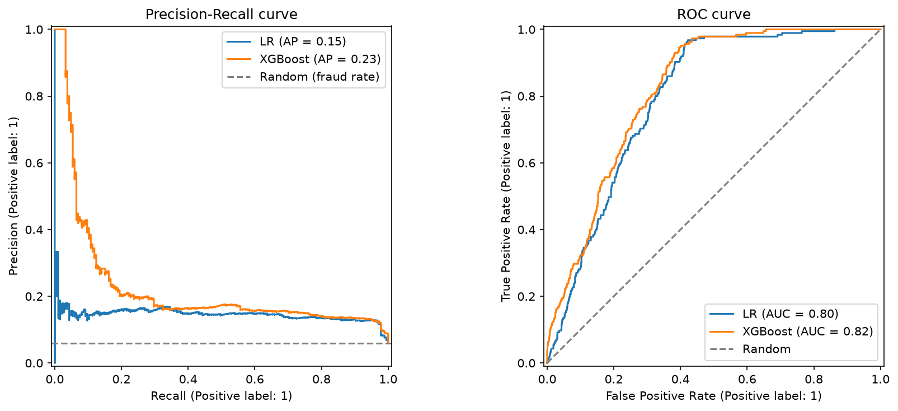
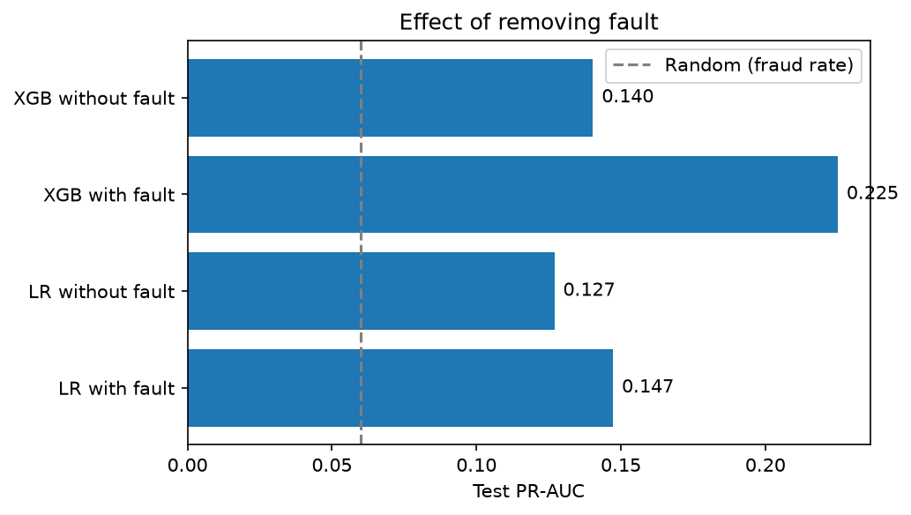
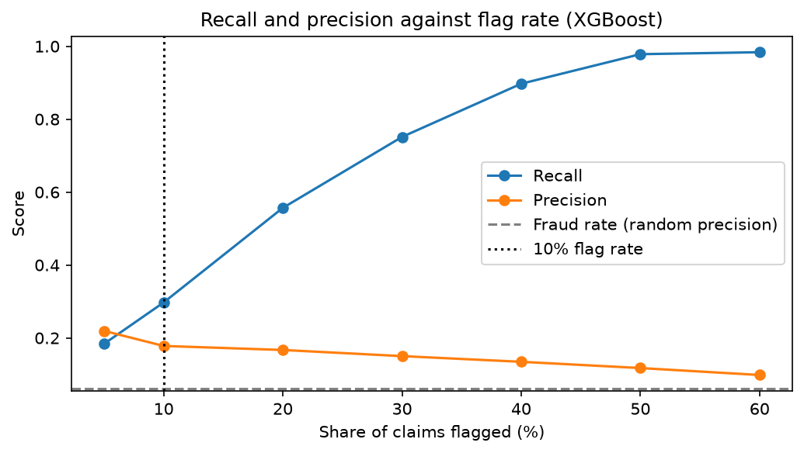

# Insurance Claims Fraud Detection

An end-to-end fraud-ranking project for vehicle insurance claims. A model scores each claim, and the riskiest ~10% are flagged for manual review.

**Main result:** on the held-out test set (3,084 claims, 185 frauds), the flagged 10% catches **55 of 185 frauds (about 30%), roughly 3x better than random review**. PR-AUC is 0.225, against 0.06 for a random model.

**Key caveat:** the model depends heavily on the `fault` column. Without it, PR-AUC drops to 0.140. See the notebook for the comparison.

## Engineering

- **Leak-free modelling:** WOE encoding sits inside the sklearn Pipeline, so it is learned from training folds only.
- **Experiment tracking:** MLflow logs parameters, metrics and the trained model.
- **Tested scoring:** a test checks that scoring one claim through `predict.py` gives the same score as the batch pipeline, which guards against training-serving skew.
- **Service:** a FastAPI endpoint scores a claim from 13 input fields, with a Streamlit front end on top.
- **Packaging:** a Dockerfile for the API, and GitHub Actions CI that runs the tests on every push.

## Structure

```
Insurance_Fraud_Detection/
├── .github/workflows/ci.yml   # runs the tests on every push
├── data/                      # fraud_oracle.csv (Download from Kaggle)
├── Notebook/
│   ├── 01_fraud_eda_and_prep.ipynb
│   └── 02_fraud_modeling_and_evaluation.ipynb
├── artifacts/                 # cleaner_params.json, threshold.json (pipeline.pkl is gitignored)
├── reports/                   # saved plots
├── src/insurance_fraud_detection/
│   ├── config.py              # paths and constants
│   ├── data_prep.py           # load, split, drop bad rows
│   ├── preprocessing.py       # cleaner, pooling, ordinal mapping
│   ├── features.py            # WOEEncoder
│   ├── evaluate.py            # PR-AUC, ROC-AUC, Gini, KS, top-10% capture
│   ├── train.py               # trains, logs to MLflow, saves artifacts
│   └── predict.py             # loads artifacts, scores one claim
├── app/
│   ├── api.py                 # FastAPI, calls predict.py
│   ├── options.py             # dropdown values for the front end
│   └── streamlit_app.py       # front end, calls the API
├── tests/                     # evaluate, features, preprocessing, predict
├── Dockerfile
├── pyproject.toml
├── uv.lock
└── README.md
```

## How to run

```bash
# 1. Download fraud_oracle.csv from Kaggle into data/
uv sync

# 2. Train. This saves the model and cutoff to artifacts/ and logs to MLflow
uv run python -m insurance_fraud_detection.train
uv run mlflow ui --backend-store-uri sqlite:///mlflow.db

# 3. Serve the API (docs at http://127.0.0.1:8000/docs)
uv run uvicorn app.api:app

# 4. Front end, in a second terminal
uv run streamlit run app/streamlit_app.py

# Or run the API in Docker (after step 2)
docker build -t fraud-api .
docker run --rm -p 8000:8000 fraud-api

# Tests
uv run pytest
```

## Reports





## Limitations

A common public dataset with a low performance ceiling. The model needs `fault` at scoring time. There is no drift monitoring, calibration or cloud deployment. The demo flags claims for review and is not a fraud verdict.
